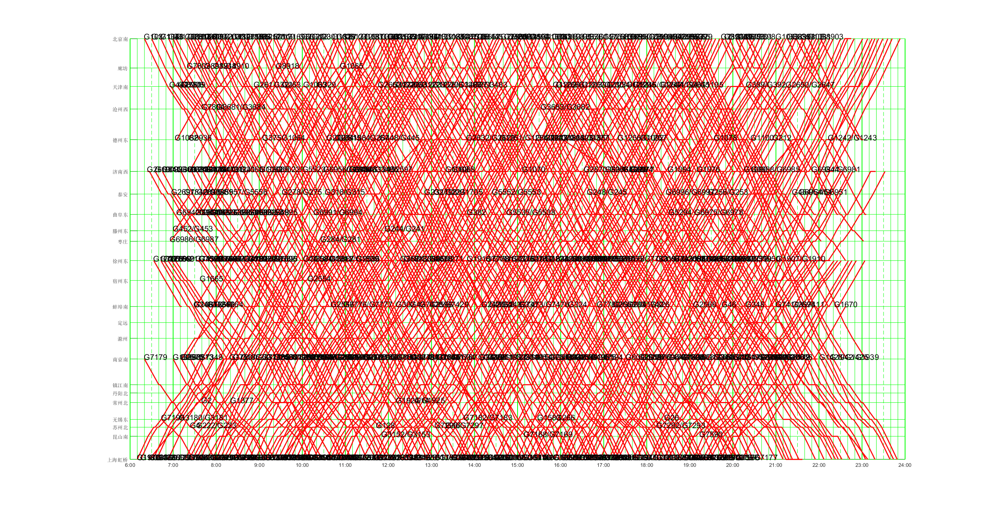

# 十分格列车运行图绘制和相关代码

    

    

    
    
    

仓库链接:
[HTTPS链接：https://github.com/netcis-railway/PlotTrainDiagram.git](https://github.com/netcis-railway/PlotTrainDiagram.git)
[SSH链接：git@github.com:netcis-railway/PlotTrainDiagram.git](git@github.com:netcis-railway/PlotTrainDiagram.git)

参考《列车运行图编制管理规则》（中国铁道出版社 2008年）、《铁路线路设计规范》、《铁路技术管理规程》等行业管理性文件、技术标准与管理办法， 绘制十分格列车运行图的作图代码。

[]

@龙麟 计划调整图vs基本图代码（蓝色基本图，红色调度调整计划图）， 保持原有基于v3f版的基础作图程序，补充到DrawTrainDigramFunctionV3f版目录下，也放到这个子目录下，新建一个代码文件(比如 plotTTScheduledvsBase.m)

@王骞 v4版的作图程序，新建目录 DrawTrainDiagramV4
